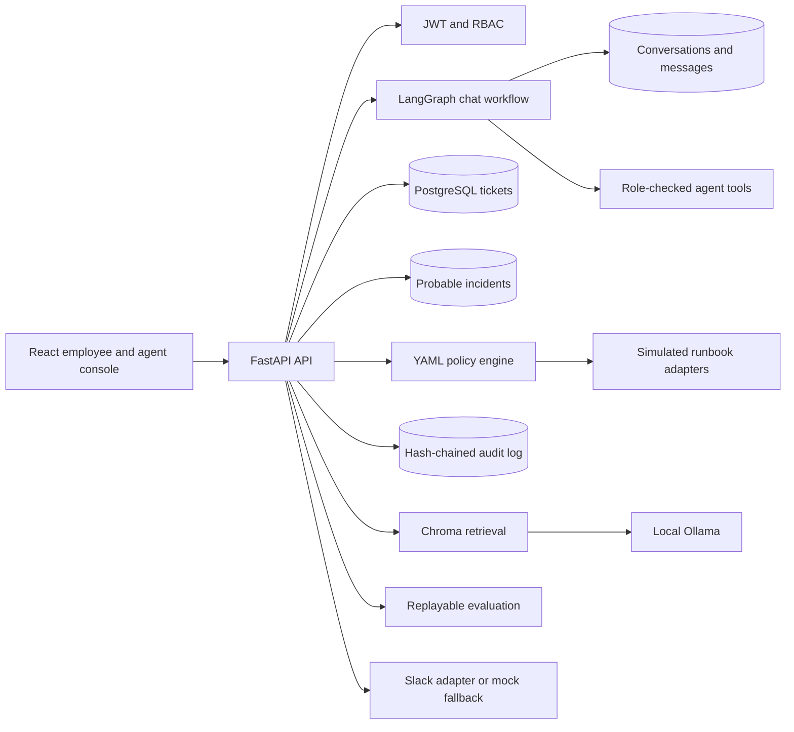

# LocalOps Helpdesk

[](https://github.com/Ayush-coo/it-agent-helpdesk/actions/workflows/ci.yml)

LocalOps Helpdesk is a local-first, policy-gated incident-aware IT operations agent for small teams in campuses, clinics, and MSPs where ticket text and operational evidence must stay on the network. Unlike generic employee chatbots or ticket-deflection tools, it clusters correlated failures into probable incidents, exposes evidence and calibrated uncertainty, blocks risky actions until policy and approval allow them, and keeps a tamper-evident audit trail. Ollama and Chroma provide local reasoning and retrieval; simulated adapters are clearly marked until connected to real systems.

## Architecture



## Feature status

| Capability | Status | Notes |
|---|---|---|
| Stateful helpdesk agent | Real / simulated identity adapter | LangGraph, last-10-message context, citations, ticket handoff, and next-turn OTP confirmation |
| JWT auth, RBAC, ticket lifecycle | Real | Persisted through SQLAlchemy/Alembic |
| Probable-incident clustering | Real | Time window, shared attributes, Ollama embeddings with lexical fallback |
| Outage replay simulator | Real | Deterministic synthetic traffic with injected outage scenarios |
| YAML runbook policy | Real | Risk, approver, preconditions, dry-run, rollback, rate/hours metadata |
| Runbook infrastructure changes | Simulated | Handlers return simulated outcomes; no endpoint or IAM mutation occurs |
| Calibrated abstention | Real | Evidence, threshold, reliability curve, safety metrics |
| Knowledge-debt drafting | Real / simulated fallback | Human approval is required before Chroma ingestion |
| Ollama reasoning and Chroma retrieval | Real when local services are available | No cloud model dependency |
| Slack notification | Real adapter / mock fallback | Configure `SLACK_WEBHOOK_URL` to use the webhook |

## Quickstart

### Docker

```powershell
Copy-Item .env.example .env
# Set JWT_SECRET_KEY to a long random value before using production mode.
docker compose up --build
```

Open `http://localhost:5173/login`. The backend API is at `http://localhost:8000/docs`; `/metrics` requires an agent or admin bearer token. Docker starts PostgreSQL, Ollama, Chroma persistence, Alembic migrations, and the nginx-served frontend. Pull local models separately when Ollama is ready:

```powershell
docker exec it-agent-ollama ollama pull llama3.1:8b
docker exec it-agent-ollama ollama pull nomic-embed-text
```

### Host development

```powershell
Copy-Item .env.example .env
.\start-dev.ps1
```

Or run the backend from `backend/` and the frontend from `frontend/` separately. Host development defaults to PostgreSQL on `localhost`; Compose overrides the database hostname to `db`.

## Validation and evaluation

```powershell
cd backend
python -m pytest tests
python -m eval.run
python -m scripts.verify_audit
```

The evaluation command writes [`backend/eval/report.md`](backend/eval/report.md) from 138 unique labelled synthetic tickets and 8 held-out retrieval questions. The measured results are:

| Metric | Result |
|---|---:|
| Severity accuracy | 67.4% |
| Category accuracy | 76.1% |
| P1/P2 recall | 68.5% |
| Held-out lexical retrieval hit@3 | 62.5% |

The incident replay utility no longer reports a keyword-baseline comparison. Retrieval hit@3 is measured against a fixed local article corpus; it is not a production Chroma/Ollama quality claim.

## Security model

- Production startup rejects the default JWT secret.
- PII and secrets are redacted before text reaches the local LLM.
- Ticket text cannot approve or bypass policy decisions.
- User and knowledge-base text cannot grant tool permissions or authorize access to other users' data.
- Password reset and account unlock require a mock OTP and explicit confirmation in a later chat turn; results are recorded in ticket events.
- Dry-run is the default for every policy action.
- State-changing actions require the configured approver role and explicit approval.
- Escalation approval requests are persisted and audited; requesters cannot approve their own tickets.
- Repeated login, registration, chat, and OTP failures trigger a temporary lockout after five failures.
- The standalone `/metrics` endpoint requires an authenticated agent or admin.
- Every action decision and outcome is recorded in a hash chain that can be verified.
- P1/P2 and low-confidence triage abstain or escalate instead of guessing.
- Simulated adapters never claim to have changed external infrastructure.

## Limitations

- Runbooks are simulated and require real adapters for IAM, endpoint, VPN, and print systems.
- Ollama model quality depends on the locally installed model and hardware.
- The lexical embedding fallback is less precise than a live Ollama embedding model.
- The evaluation data is synthetic and should not be presented as production accuracy.
- Docker, Ollama model pulls, and Slack delivery were not verifiable in this Windows environment because Docker was unavailable.

## Roadmap

1. Connect approved IAM, endpoint, network, and ITSM adapters behind the existing policy interface.
2. Add production-labelled incident and KB datasets with human-reviewed calibration.
3. Add SSO, asset inventory, SLA reporting, and notification delivery.

## Resume bullets

- Built auditable incident-aware support workflows that turn correlated ticket patterns into escalation and resolution paths.
- Implemented keyword triage with 67.4% severity accuracy, 76.1% category accuracy, and 68.5% P1/P2 recall on 138 unique synthetic tickets.
- Added calibrated abstention, separate-user audited escalation approvals, policy-derived runbook RBAC, five-failure lockouts, PII redaction, and hash-chain audit verification.
- Measured 62.5% hit@3 on 8 held-out questions against a fixed local knowledge-article corpus.
